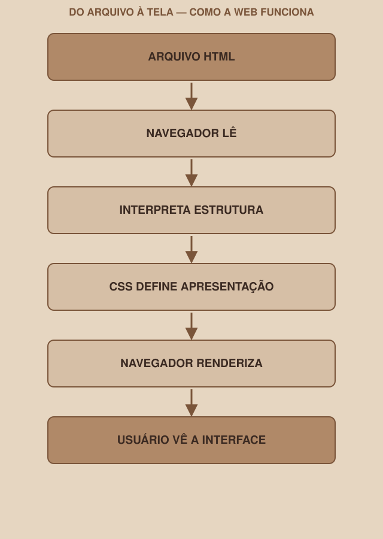

# Module 01 | How the Web Works

[Português](../docs/01-como-a-web-funciona.md) · English

`WEEK 02 // Web Interface, Part 1: Layout`

---

## // Before the first HTML

It is tempting to open a code editor and start writing tags right away. But before that, it is worth answering a question most people never stopped to ask: what exactly happens between you creating a file and someone seeing a page on the screen?

Without that answer, HTML and CSS look like magic. With it, every module that comes next makes sense as a piece of a mechanism, not as a memorized trick.

## // Browser, website, page: clearing up the confusion

> **CONCEPT: IN SIMPLE WORDS**
> - **Browser**: the program that reads web files and shows the result on the screen (Chrome, Firefox, Safari, Edge).
> - **Page**: a single HTML file, with its content and structure.
> - **Website**: a set of related pages (Login, Dashboard and Profile, together, make a website).
> - **File**: where all of this physically lives. `.html` for structure, `.css` for style.

## // A server, in one sentence

You do not need to understand servers in depth this week; that is a topic for future modules of the club. But the minimum concept matters:

> **SERVER: IN SIMPLE WORDS**
> A server is a computer (usually far from yours, always on) that stores files and sends them when someone asks, through an address (URL). When you type `google.com`, your browser is asking Google's server for files.

## // Local file × website on the web

There is a practical difference you will feel this week:

| | Local file | Website on the web |
|---|---|---|
| Where it is | On your computer | On a server |
| How you access it | Opening the file directly (double-click, or dragging it into the browser) | Typing a URL |
| What you will do this week | This: open `login.html` locally to test | This comes in future weeks, when the project is hosted |

This week, all your work happens in local files. There is no address on the internet yet, and there does not need to be.

## // The browser's role

> **BROWSER: IN SIMPLE WORDS**
> The browser is a program that knows how to read HTML and CSS files and turn that text into something visual and interactive on the screen.
>
> Technically: the browser interprets (*parses*) the HTML, builds a tree representation of the document, applies the CSS rules to that tree, and paints the result on the screen: a process called rendering.

Here is the full path:

Each arrow in this diagram is a real step, which happens every time a page opens, including the ones you will create this week.

## // HTML, CSS and JavaScript | the three roles

A simple way to lock in the difference, just as a starting point:

> **ANALOGY: ONLY AS AN INITIAL AID**
> HTML is the structure of a house: walls, rooms, doors.
> CSS is the finish: wall color, type of floor, visual arrangement.
> JavaScript is the behavior: the door opening when you ring the bell.

This analogy is only meant to help you memorize the three roles; drop it from here on and think in the real technical terms:

- **HTML** defines **structure**: what exists on the page and what each part means.
- **CSS** defines **presentation**: how each part looks visually.
- **JavaScript** defines **behavior**: what happens when something changes (a click, typing).

> **IMPORTANT**
> JavaScript is not the focus of Week 02. You will see the word a few times, but you will not write programming logic this week: only structure (HTML) and presentation (CSS). A button can exist, visually, without a single line of JavaScript behind it.

## // Applying it to the week's project

Before moving on to Module 02, check your environment:

1. Choose a code editor to use for the whole week (VS Code is a good free option, but any simple text editor works to start).
2. Create a folder for the project, if you do not already have a clear folder from Week 01.
3. Inside it, create an empty `teste.html` file and write only the word `Hi`.
4. Open that file by dragging it into the browser (or double-clicking). Check: did the browser show "Hi" on the screen, even without any tag?

That confirms the environment is working, and shows, in practice, that the browser displays any content, even without structure. That "without structure" is exactly what the next module solves.

## // Checkpoint

> **BEFORE MOVING ON, THINK ABOUT THIS**
> A classmate says: "I don't need to learn HTML, I only use Tailwind." What does that sentence ignore about the browser's role in the process you just saw?

Answer: Tailwind generates CSS; it handles the presentation step. But the browser still needs an HTML structure to apply that CSS on top of. Without HTML, there is no "where" for the CSS (Tailwind included) to act. Tailwind replaces writing CSS by hand; it does not replace HTML.

## // Module summary

- [ ] I know the difference between browser, website and page.
- [ ] I can explain, in one sentence, what a server is.
- [ ] I know the difference between opening a local file and accessing a website on the web.
- [ ] I know the full path: file → browser reads → interprets → CSS applies → renders → user sees.
- [ ] I know the three roles: HTML (structure), CSS (presentation), JavaScript (behavior), and I know JS is not the focus this week.
- [ ] My environment (editor + project folder) is ready.

---

**Next module:** `02-html.md`: the first piece of the mechanism: how to give structure to text.

`Study Material // Coffee & Code`
