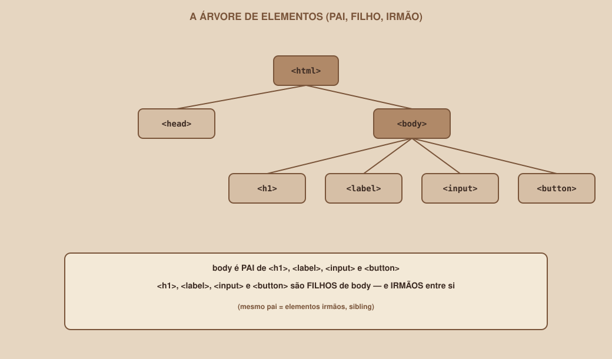

# Module 02 | HTML: Page Structure

[Português](../docs/02-html.md) · English

`WEEK 02 // Web Interface, Part 1: Layout`

---

## // Before you start

In Module 01 you saw the general model: file → browser reads → interprets structure → CSS defines presentation → browser renders → you see an interface. This module goes into the first piece of that model: how structure is written, in a way the browser can interpret.

Throughout the module, we will build the beginning of the guide project's **Login** screen.

## // The problem: plain text has no meaning at all

Imagine you receive this in a notepad:

```
Sign in

Email

Password

Sign in
```

That is text. A browser can even show plain text on the screen, but it has no idea that the first line is a heading, that "Email" and "Password" are labels for fields the person should fill in, or that the last "Sign in" is a clickable button. To the browser, it is just five lines of text, with no hierarchy, no function, no meaning.

> **THE MAIN POINT**
> Without a way to mark what each part of the text *is*, there is no difference between a heading, a paragraph and a button: just letters on the screen. That is the problem HTML solves.

## // What is HTML?

> **HTML: IN SIMPLE WORDS**
> HTML is a way of "marking" pieces of text, telling the browser what each piece represents: this is a heading, this is a paragraph, this is a button.
>
> Technically: HTML (HyperText Markup Language) is a markup language, not a programming language. It does not calculate, decide or repeat actions. It describes the structure and meaning of a page's content.

It is worth pausing on the term "markup language", because it explains the most important difference in this module. A *programming* language (like JavaScript, which you will meet in future weeks) gives behavior instructions: "if this happens, do that". A *markup* language does not instruct behavior; it labels content. HTML cannot do anything on its own; it just says "this is a heading" and lets the browser decide how to show a heading.

## // From plain text to HTML

Back to the earlier example, see what happens when each line gets markup:

```html
<h1>Sign in</h1>

<label>Email</label>
<input type="email">

<label>Password</label>
<input type="password">

<button>Sign in</button>
```

Nothing about the *content* changed: they are still the same words. What changed is that each piece now carries an explicit meaning: `<h1>` says "this is the most important heading on the page", `<label>` says "this is a field's label", `<input>` says "this is a field where the person types something", `<button>` says "this is something clickable that triggers an action". The browser reads these marks and already knows, without guessing, how to treat each part.

## // Tag, element, content, attribute

Four terms that will show up all the time; better to lock them in now, with a concrete example:

```html
<label for="email">Email</label>
```

| Term | What it is | In this example |
|---|---|---|
| Tag | The mark itself, between `<` and `>` | `<label>` (opening) and `</label>` (closing) |
| Element | The opening tag + the content + the closing tag, as a whole | The whole `<label for="email">Email</label>` |
| Content | What sits between the opening and the closing | `Email` |
| Attribute | Extra information, written inside the opening tag | `for="email"` |

Notice that the closing tag is almost the same as the opening one, just with a slash (`/`) before the name: `<label>` opens, `</label>` closes. Forgetting to close a tag is one of the most common beginner mistakes: the browser tries to guess where it should end, and the result is rarely what you expected.

Some elements have no content and no separate closing tag: `<input type="email">`, for example, is a complete element on its own, because a form field does not "contain" text between an opening and a closing.

## // Nesting: parent, child and sibling elements

HTML is rarely a flat list of elements; they sit inside one another. This is called *nesting*, and it is the basis of how an entire page is organized.

<div align="center">

</div>

Three terms come directly from this idea of nesting:

- **Parent element**: an element that contains other(s) inside it. In the diagram, `<body>` is the parent of `<h1>`, `<label>`, `<input>` and `<button>`.
- **Child element**: an element that is inside another. `<h1>` is a child of `<body>`.
- **Sibling element**: elements that share the same parent. `<h1>`, `<label>`, `<input>` and `<button>` are all siblings, because they are all direct children of `<body>`.

This parent/child/sibling relationship is not just a vocabulary detail: in Module 06 (Flexbox) and Module 07 (Grid), practically every CSS layout property you will learn acts exactly on this relationship: a container (parent) arranging its items (children).

## // Indentation: why the way you write matters

Indentation (the spaces at the start of each line) changes absolutely nothing for the browser; it reads the HTML without caring about extra spaces. But it changes everything for you and for anyone who reads your code later:

```html
<!-- Hard to read: without indentation, the nesting does not show -->
<body>
<h1>Sign in</h1>
<label>Email</label>
<input type="email">
</body>

<!-- Easy to read: indentation visually reveals who is a child of whom -->
<body>
  <h1>Sign in</h1>
  <label>Email</label>
  <input type="email">
</body>
```

The most common convention is 2 spaces per nesting level. Code editors usually do this automatically when you press Tab, but it is worth understanding that it is a human convention, not a browser rule.

## // The minimum structure of a page

Every HTML file starts with the same skeleton:

```html
<!DOCTYPE html>
<html lang="pt-BR">
<head>
  <meta charset="UTF-8">
  <meta name="viewport" content="width=device-width, initial-scale=1.0">
  <title>Login | Buscador de Grupos de Estudo</title>
</head>
<body>

</body>
</html>
```

None of this is decoration; each line exists for a reason:

| Part | What it does |
|---|---|
| `<!DOCTYPE html>` | Tells the browser this document uses the HTML5 standard (the current version) |
| `<html lang="pt-BR">` | Root element: wraps the whole document. `lang` states the language, which helps screen readers and automatic translators (use `lang="en"` for a page in English) |
| `<head>` | Holds settings and metadata that do not appear as visible page content |
| `<meta charset="UTF-8">` | Ensures accents and special characters (ã, ç, é) display correctly |
| `<meta name="viewport" ...>` | Tells the phone's browser not to simulate a desktop screen: essential for responsiveness (Module 08) |
| `<title>` | Sets the text that appears on the browser tab |
| `<body>` | Contains everything that actually appears on the page for whoever is looking |

Notice that `<head>` and `<body>` are siblings (both are direct children of `<html>`) and that **everything a person sees** lives inside `<body>`. That is where the rest of this module happens.

## // Essential elements, one at a time

### > Headings

```html
<h1>Main heading</h1>
<h2>A subheading</h2>
```

There are six levels, `<h1>` to `<h6>`, from most to least important. A page should have only one `<h1>`, the most important heading on that screen, and the other levels organize the content below it in logical order, without skipping levels (an `<h3>` should not appear without an `<h2>` before it in the same section). This matters more than it seems: screen readers use these levels to navigate the page, so a messy hierarchy directly hurts accessibility, a topic that comes back in more depth in Module 12.

### > Paragraphs

```html
<p>Find classmates studying the same subject as you.</p>
```

### > Links

```html
<a href="cadastro.html">Don't have an account yet? Sign up</a>
```

`href` is an attribute: the address the link leads to.

### > Images

```html

```

`alt` is not optional in practice: it is the text that shows up if the image does not load, and what a screen reader reads aloud to a person with a visual impairment. An image without `alt` is an image that simply does not exist for some of the people who visit your page.

### > Lists

```html
<ul>
  <li>Calculus I</li>
  <li>Data Structures</li>
</ul>
```

`<ul>` is a list with no defined order (bullets); `<ol>` would be a numbered list. Each item lives inside an `<li>`.

### > Buttons

```html
<button>Sign in</button>
```

## // Guided example: building the top of the Login

Putting together what we have seen so far, inside the `<body>` of the Login file:

```html
<body>
  <h1>Sign in</h1>
  <p>Access your account to see your study groups.</p>
</body>
```

This is already a valid HTML page, without any CSS or styling: the browser already knows how to display a big heading followed by a paragraph. It is not much visually, but it is structurally correct, and that is exactly the kind of correctness the next modules (Forms, then CSS) build on.

## // Good example × bad example

**Bad example**: everything is a div, nothing has meaning:

```html
<div>Sign in</div>
<div>Access your account to see your study groups.</div>
```

The browser can display this, but it lost all information about what each line *is*. Visually it may look the same after applying CSS, but semantically these two lines became generic text, indistinguishable from each other for any tool (screen reader, search engine) that depends on meaning, not just appearance.

**Good example**: each line carries its own meaning:

```html
<h1>Sign in</h1>
<p>Access your account to see your study groups.</p>
```

We will dig into exactly this point, generic `<div>` × meaningful element, in Module 03, when semantic HTML comes into play.

## // Common mistakes

| Mistake | Why it happens | How to fix it |
|---|---|---|
| Forgetting the closing tag | Easy to lose track of in elements with a lot of content inside | Always close it right when you open it, before filling in the content |
| Nesting tags out of order (`<p><h1>...</p></h1>`) | Typing fast without paying attention to the order | Close tags in the reverse order you opened them: the last one opened is the first one closed |
| Using `<div>` for everything | It seems simpler not to think about which element to use | Ask "what *is* this?" before writing the tag |
| Forgetting `alt` on images | Not thinking about people who use screen readers | Treat `alt` as a required part of every `` tag |
| Skipping heading levels (`<h1>` straight to `<h4>`) | Choosing the size by looks, not by hierarchy | Choose the level by logical importance; adjust the size later, with CSS |

## // Guided practice

Let's build the full skeleton of the Login page together.

1. Create a file called `login.html`.
2. Add the minimum structure (`<!DOCTYPE html>` to `</html>`), with the `<title>` "Login | Buscador de Grupos de Estudo".
3. Inside `<body>`, add an `<h1>` with the text "Sign in".
4. Right below it, add a `<p>` briefly explaining what the screen does.
5. Add an `<a>` linking to a future sign-up page (the destination can be `cadastro.html`, even if that file does not exist yet).
6. Save and open the file directly in the browser (drag the file into a tab, or double-click it).
7. Check: does the title show up on the browser tab? Does the `<h1>` look bigger than the `<p>`? Does the link look underlined and blue (the browser's default style, with no CSS yet)?

## // Practice on your own

> **CHALLENGE**
> Create a second file, `cadastro.html`, with the same minimum structure. Inside `<body>`, add an `<h1>` "Create account", a short `<p>`, and an `<a>` link back to `login.html`. At the end, click the link from `login.html` to `cadastro.html` and back, confirming that navigation between the two files works.

## // Applying it to the week's project

1. In your project repository, create the `pages/` folder (or use the root, if you prefer a simpler structure for now).
2. Create `login.html` with the structure you practiced above, using the text and elements that make sense for the Login screen of *your* Figma prototype; it does not need to be identical to the Study Group Finder.
3. Apply the same reasoning (without copying the CSS yet, which comes in Module 04) to at least the heading and an opening paragraph of the Dashboard and Profile screens.
4. Commit: `git add .` and `git commit -m "Add initial HTML structure for the three screens"`.

## // Checkpoint

> **BEFORE MOVING ON, THINK ABOUT THIS**
> You have this HTML snippet:
> ```html
> <section>
>   <h2>My groups</h2>
>   <p>You are in 3 groups.</p>
> </section>
> ```
> Who is the parent of whom here? And who are siblings?

Answer: `<section>` is the parent of `<h2>` and `<p>`. `<h2>` and `<p>` are direct children of `<section>`, and, since they share the same parent, they are siblings.

## // Module summary

- [ ] I can explain what "markup language" means, and why HTML is not a programming language.
- [ ] I know the difference between tag, element, content and attribute.
- [ ] I know what parent, child and sibling elements mean, and why it matters for the next modules.
- [ ] I can build the minimum structure of an HTML file and explain each part of it.
- [ ] I can use headings, paragraphs, links, images, lists and buttons.
- [ ] I have at least the HTML skeleton of my project's three screens.

---

**Next module:** `03-semantic-html-and-forms.md`. `<div>` works, but it is almost never the right choice. Time to learn why.

`Study Material // Coffee & Code`
