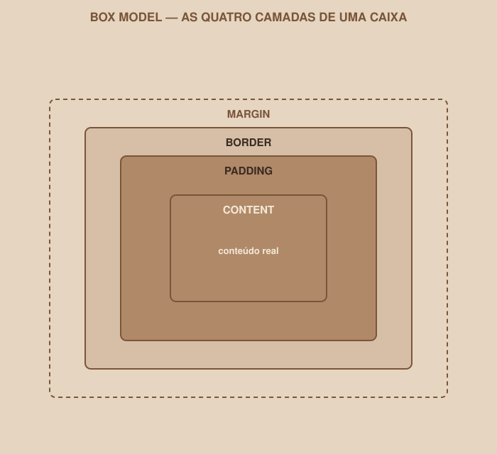

# Module 05 | Box Model, Sizes and Spacing

[Português](../docs/05-box-model-e-unidades.md) · English

`WEEK 02 // Web Interface, Part 1: Layout`

---

## // The problem

You set `width: 300px` on an element, add 20px of `padding` and a 2px `border`, and the final element is not 300px wide. It is wider. This confuses practically everyone who starts with CSS, and the reason has a name: the Box Model.

## // Every element is a box

> **BOX MODEL: IN SIMPLE WORDS**
> The browser treats practically every HTML element as a rectangular box, made up of four layers, one inside the other: content, inner spacing, border and outer spacing.

<div align="center">

</div>

| Layer | What it is |
|---|---|
| `content` | The content itself: text, image, and the dimensions set by `width`/`height` |
| `padding` | Inner space, between the content and the border |
| `border` | The outline of the box |
| `margin` | Outer space, which pushes this box away from neighboring boxes |

## // Padding × margin: the most common confusion

Both create space, but in opposite places:

- **Padding** pushes the content *inward* within the box itself: it makes the box bigger, keeping distance between the content and the border.
- **Margin** pushes the whole box *away* from other boxes: it does not affect the size of the box itself, only the space around it.

```css
.card {
    padding: 20px;  /* space between the card's border and the text inside it */
    margin: 16px;   /* space between this card and the next element */
}
```

## // The calculation that confuses everyone

```css
.card {
    width: 300px;
    padding: 20px;
    border: 2px solid;
}
```

By default, the browser calculates `width` considering **only the content**. So the final visible size of this box is:

```
300px (content) + 20px + 20px (padding, both sides) + 2px + 2px (border, both sides)
= 344px total width
```

In other words: `width: 300px` does not mean "this box will take up 300px"; it means "the content will be 300px, and padding/border are added on top".

## // `box-sizing: border-box`

```css
* {
    box-sizing: border-box;
}
```

This declaration changes the calculation rule: with `border-box`, `width` now represents the **final** size of the box, already including padding and border. In the previous example, with `border-box`, the box would be exactly 300px: the browser automatically shrinks the space available for the content, to fit padding and border inside the 300px.

> **WHY USE `BORDER-BOX`**
> With `border-box`, the size you write is the size you get: much more predictable when building a layout. That is why practically every professional project starts its CSS with this rule applied to `*` (all elements), right at the top of the file.

## // Sizes and units

Not every number in CSS means "pixels". Each unit solves a different problem:

| Unit | Solves | Example |
|---|---|---|
| `px` | Fixed, exact size | `border: 1px solid;` |
| `%` | Size relative to the parent element's available space | `width: 100%;`: takes up all available width |
| `rem` | Size relative to the page's base font size | `font-size: 1.5rem;`: scales along if the base changes |
| `em` | Size relative to the element's own font size | Use with care: it can compound unexpectedly in nested elements |
| `vw` / `vh` | Percentage of the **screen's** width/height (viewport) | `height: 100vh;`: takes up the full screen height |
| `fr` | Fraction of the available space: only exists inside Grid | Comes back in detail in Module 07 |

> **WHEN EACH UNIT CAN CAUSE PROBLEMS**
> `px` is too fixed for text and does not respect the accessibility settings of the person's browser. `%` depends entirely on the parent element having a defined size; without that, the result is unpredictable. `vh` on phones can behave inconsistently because of the mobile browser's bars. There is no universally "right" unit; there is the right unit for each situation, and you will develop that instinct with practice.

For font size and spacing, `rem` is usually the safest choice: it is the standard we will use in the design system in code, in Module 11.

## // Good example × bad example

**Bad example**: unpredictable sizes, without `border-box`:

```css
.card {
    width: 300px;
    padding: 24px;
    border: 3px solid;
    /* real final size: 300 + 24*2 + 3*2 = 354px, not 300px */
}
```

**Good example**: predictable, with global `border-box`:

```css
* {
    box-sizing: border-box;
}

.card {
    width: 300px;
    padding: 24px;
    border: 3px solid;
    /* real final size: exactly 300px */
}
```

## // Common mistakes

| Mistake | Why it happens | How to fix it |
|---|---|---|
| Forgetting `box-sizing: border-box` | It is not the browser's default | Add `* { box-sizing: border-box; }` right at the top of the CSS |
| Mixing up padding and margin when spacing elements | Both "create space" | Ask: do I want space *inside* the box (padding) or *between* boxes (margin)? |
| Using `px` for everything | It seems simpler at first | Consider `rem` for fonts and spacing, keeping `px` for thin borders |
| Element "bigger than it should be" | `width` without `border-box`, adding padding/border | Check whether `box-sizing: border-box` is applied |

## // Guided practice

1. In `styles.css`, add `* { box-sizing: border-box; }` as the first rule in the file.
2. In the Login form, add `padding` to the fields (`input`) so the typed text does not stick to the border.
3. Add `margin-bottom` between the fields, so they do not stick to each other.
4. Try temporarily removing `box-sizing: border-box` and visually observe the difference in the size of the elements, then put it back.

## // Practice on your own

> **CHALLENGE**
> Choose a Dashboard card (even if still simple) and explicitly set: `width`, `padding`, `border` and `margin`. Calculate by hand, on paper, what the final size of the box would be without `border-box`, and check with the browser's DevTools (right-click the element → Inspect) whether the calculated value matches your math.

## // Applying it to the week's project

1. Make sure `box-sizing: border-box` is at the top of the project's `styles.css`.
2. Review the spacing (padding and margin) of the main elements on the three screens, using a consistent scale (for example, multiples of 4 or 8, as already defined in the Week 01 design system).
3. Commit: `git commit -m "Apply Box Model and a consistent spacing scale"`.

## // Checkpoint

> **BEFORE MOVING ON, THINK ABOUT THIS**
> Your button has `width: 200px`, `padding: 20px` and `border: 2px`. With `box-sizing: content-box` (the browser's default), does it really take up only 200px? Explain.

Answer: no. With `content-box` (the default), `width` sets only the content area; padding and border are added on the outside. The final size would be 200 + 20×2 + 2×2 = 244px. Only with `box-sizing: border-box` would the 200px represent the total size of the box.

## // Module summary

- [ ] I can name the four layers of the Box Model, from inside out.
- [ ] I can explain the difference between padding and margin without hesitating.
- [ ] I can calculate the final size of a box, with and without `border-box`.
- [ ] I know when to use `px`, `%`, `rem` and `vw`/`vh`, and why each one exists.
- [ ] My project's CSS already has `box-sizing: border-box` applied globally.

---

**Next module:** `06-flexbox.md`: three buttons insist on staying stacked. Time to control how elements are distributed.

`Study Material // Coffee & Code`
