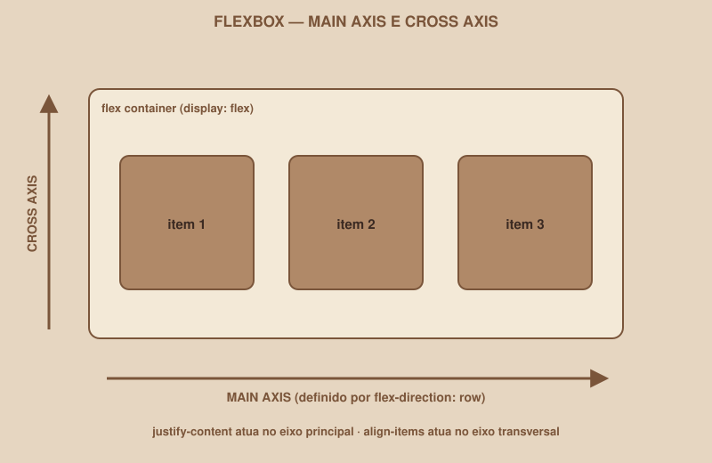

# Module 06 | Flexbox

[Português](../docs/06-flexbox.md) · English

`WEEK 02 // Web Interface, Part 1: Layout`

---

## // The problem

You have three buttons in the HTML:

```html
<button>Cancel</button>
<button>Save draft</button>
<button>Sign in</button>
```

By default, each one sits on its own line, stacked vertically; that is how the browser naturally arranges elements like `<button>`, one below the other. But you want:

```
[ Cancel ] [ Save draft ] [ Sign in ]
```

Side by side. How do you control that?

## // The idea behind the solution

We need a way to control how child elements are distributed inside a parent element: their direction, the space between them, their alignment. That is exactly what Flexbox solves.

## // What Flexbox is

> **FLEXBOX: IN SIMPLE WORDS**
> Flexbox is a CSS layout mode that arranges an element's direct children in a single direction (row or column), controlling how space is distributed among them.

## // Container, items, and the two axes

Three terms show up in every Flexbox property:

- **Flex container**: the parent element, where you turn Flexbox on.
- **Flex items**: the direct children of that container, arranged by it.
- **Main axis** and **Cross axis**: the two directions Flexbox understands, perpendicular to each other.

<div align="center">

</div>

The main axis depends on the direction you choose (`flex-direction`): if it is `row` (the default), the main axis is horizontal. If it is `column`, the main axis becomes vertical, and the cross axis horizontal.

## // Turning Flexbox on

```css
.barra-botoes {
    display: flex;
}
```

This single line already solves the initial problem: the `<button>` elements that were direct children of `.barra-botoes` now sit side by side, automatically.

## // The properties, one at a time

### > `flex-direction`

```css
.barra-botoes {
    display: flex;
    flex-direction: row; /* default: can be omitted */
}
```

`row` arranges horizontally (the default); `column` arranges vertically, like a stack. But, unlike HTML's natural stacking, now you control the spacing and alignment between the items.

### > `justify-content` | alignment on the main axis

```css
.barra-botoes {
    display: flex;
    justify-content: space-between;
}
```

Controls how items are distributed along the main axis. Common values: `flex-start` (start), `center`, `flex-end` (end), `space-between` (equal space *between* items, no space at the ends), `space-around` (equal space around each item).

### > `align-items` | alignment on the cross axis

```css
.barra-botoes {
    display: flex;
    align-items: center;
}
```

Same logic as `justify-content`, but on the cross axis. In a horizontal bar (`flex-direction: row`), `align-items: center` centers the items vertically inside the container.

### > `gap`

```css
.barra-botoes {
    display: flex;
    gap: 16px;
}
```

A fixed space between items, without needing manual `margin` on each one, and without the risk of leftover margin in the first or last position.

### > `flex-wrap`

```css
.barra-botoes {
    display: flex;
    flex-wrap: wrap;
}
```

By default, Flexbox tries to squeeze all items into a single line, even if it gets cramped. `flex-wrap: wrap` lets items wrap to the next line when they do not fit, which is important for responsiveness (Module 08).

### > `flex-grow` and `flex-shrink` | going deeper

```css
.busca {
    flex-grow: 1; /* takes up all the remaining available space */
}
```

`flex-grow` controls how much an item grows to take up extra available space; `flex-shrink` controls how much it shrinks when space runs out. You do not need to master either one now; they come up when a specific item needs to behave differently from its siblings (for example, a search field that should stretch while a button next to it keeps a fixed size).

## // Before and after, for each property

```css
/* BEFORE | without Flexbox */
.navbar { }
/* logo and links stacked, one below the other */

/* AFTER | with Flexbox */
.navbar {
    display: flex;
    justify-content: space-between;
    align-items: center;
}
/* logo on the left, links on the right, all vertically centered */
```

## // Where to use Flexbox in your project

- **Navbar**: logo on one side, actions on the other.
- **Form**: fields stacked in a column (`flex-direction: column`).
- **Row of buttons**: several buttons side by side, with even spacing.
- **Avatar + information**: image and text aligned side by side, vertically centered.

## // Common mistakes

| Mistake | Why it happens | How to fix it |
|---|---|---|
| `display: flex` on the wrong element | Applying it to the children instead of the parent | Flexbox is turned on in the **container**, and arranges its **direct children** |
| Expecting `justify-content` to align vertically in a horizontal row | Mixing up main and cross axis | `justify-content` is always the main axis; use `align-items` for the cross axis |
| Items do not wrap on small screens | Forgetting `flex-wrap` | Add `flex-wrap: wrap` when items may need more than one line |
| Using Flexbox for everything, including 2D grids | Not knowing Grid yet | Module 07 solves exactly this case |

## // Mid-module checkpoint

> **THINK ABOUT THIS BEFORE MOVING ON**
> With `flex-direction: column`, which axis does `justify-content` control now: vertical or horizontal?

Answer: vertical. The main axis changes along with `flex-direction`: with `column`, the main axis becomes vertical, so `justify-content` (which always acts on the main axis) now controls vertical alignment, and `align-items` now controls horizontal alignment.

## // Guided practice

1. In `styles.css`, create a `.navbar` class with `display: flex`, `justify-content: space-between` and `align-items: center`.
2. Apply that class to the element that wraps the logo and the navigation links on the Dashboard.
3. Create a `.form-login` class with `display: flex` and `flex-direction: column`, applied to the Login `<form>`; this stacks the fields vertically, with full control of spacing via `gap`.
4. Add `gap: 16px` to that class, and remove any manual `margin-bottom` you put on the fields in Module 05.

## // Practice on your own

> **CHALLENGE**
> On the Profile screen, arrange the avatar and the user information (name, e-mail) side by side using Flexbox (avatar on the left, text on the right), vertically centered. Then arrange the action buttons ("Edit profile", "Sign out") in a separate row, with `gap` between them.

## // Applying it to the week's project

1. Use Flexbox in the navbar/header of the three screens, for consistent alignment.
2. Use Flexbox in the Login form, to stack the fields with even spacing.
3. Use Flexbox in any row of buttons in your project.
4. Commit: `git commit -m "Apply Flexbox to the navbar, form and button rows"`.

## // Checkpoint

> **BEFORE MOVING ON, THINK ABOUT THIS**
> Your navbar has the logo on the left and a group of links on the right. Does Flexbox or Grid feel more natural here? Justify.

Answer: Flexbox. It is a one-dimensional layout problem (a single horizontal row), exactly what Flexbox solves. Grid comes in when the problem is two-dimensional (rows *and* columns at the same time), as we will see in the next module with the Dashboard cards.

## // Module summary

- [ ] I know what a flex container and a flex item are.
- [ ] I know the difference between main axis and cross axis, and how it changes with `flex-direction`.
- [ ] I can use `justify-content`, `align-items` and `gap` to solve common alignments.
- [ ] I know when to add `flex-wrap`.
- [ ] My project's navbar, Login form and at least one row of buttons already use Flexbox.

---

**Next module:** `07-grid.md`. Flexbox arranges a single row. What about when the problem has two dimensions, like the Dashboard's card grid?

`Study Material // Coffee & Code`
