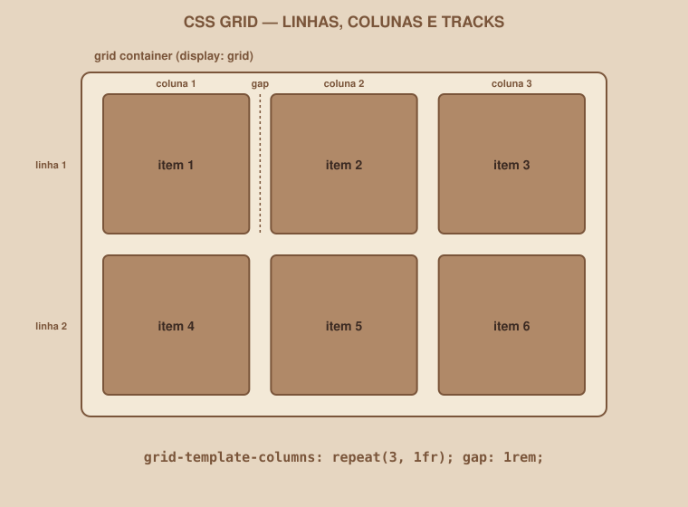
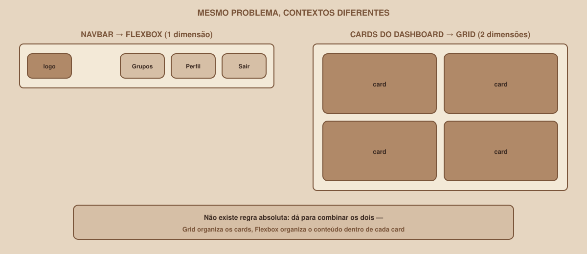

# Module 07 | CSS Grid

[Português](../docs/07-grid.md) · English

`WEEK 02 // Web Interface, Part 1: Layout`

---

## // Before you start

This module assumes Module 06 (Flexbox) is already clear. Grid solves a different problem, and the difference only makes sense after you have felt, in practice, what Flexbox solves.

## // The problem

Your project's Dashboard needs to show several study group cards, arranged in rows *and* columns at the same time:

```
[ Card ] [ Card ] [ Card ]
[ Card ] [ Card ] [ Card ]
```

You can try to force this with Flexbox (`flex-wrap: wrap`), and sometimes it even works reasonably well. But Flexbox was designed to arrange things in **one** dimension at a time; it has no native concept of "this row and the row below should have columns aligned with each other". For a truly two-dimensional structure, there is a tool made exactly for that.

## // What CSS Grid is

> **GRID: IN SIMPLE WORDS**
> Grid is a CSS layout mode that arranges an element's children in rows and columns at the same time, like a grid. Unlike Flexbox, which arranges things in a single direction.

## // Grid container, grid items, tracks

- **Grid container**: the parent element, where you turn Grid on.
- **Grid items**: the direct children, placed inside the grid.
- **Tracks**: each row or column of the grid is called a *track*.

<div align="center">

</div>

## // Turning Grid on

```css
.dashboard-grid {
    display: grid;
    grid-template-columns: repeat(3, 1fr);
    gap: 1rem;
}
```

Let's break down each part:

| Part | What it does |
|---|---|
| `display: grid` | Turns Grid mode on for this element |
| `grid-template-columns` | Defines how many columns there are, and the size of each one |
| `repeat(3, 1fr)` | Shortcut for "3 columns, each taking an equal fraction of the space": equivalent to writing `1fr 1fr 1fr` |
| `1fr` | A new unit, exclusive to Grid: a *fraction* of the available space |
| `gap: 1rem` | Space between columns and between rows, all at once |

Notice that you do not need to say anything about rows in this example: Grid automatically creates as many rows as needed to fit the items, respecting the 3 defined columns.

## // `fr`: the unit that only exists in Grid

```css
grid-template-columns: 2fr 1fr;
```

This creates two columns, where the first takes twice the space of the second: proportional, not in fixed pixels. `fr` always divides the *available* space proportionally, similar to `flex-grow` in Flexbox, but designed for whole columns and rows.

## // `minmax()` | going deeper

```css
grid-template-columns: repeat(3, minmax(200px, 1fr));
```

`minmax(200px, 1fr)` says: each column must be at least 200px, but can grow up to `1fr` if there is room. This keeps columns from getting too squeezed on smaller screens: a first step toward thinking about responsive Grid, which we explore in Module 08.

## // `auto-fit` / `auto-fill` | going deeper

```css
grid-template-columns: repeat(auto-fit, minmax(200px, 1fr));
```

Instead of a fixed number of columns, `auto-fit` lets the browser calculate how many columns fit, respecting the minimum size from `minmax()`: the number of columns adjusts automatically as the screen gets wider or narrower, without needing a media query for it.

## // Flexbox × Grid, side by side

<div align="center">

</div>

"Flex is 1D, Grid is 2D" is true, but on its own it does not explain much. In practice:

- **Flexbox**: when you are arranging a sequence of items in a row or column, where each item's size can vary naturally with its content.
- **Grid**: when you need a structure where rows *and* columns matter at the same time, with items aligned in both directions.

> **THERE IS NO ABSOLUTE RULE**
> The two can be, and usually are, combined in the same project: Grid arranges the Dashboard cards (the whole grid), and Flexbox arranges the content *inside* each individual card (the title, description and button, aligned in a column). One does not replace the other; they solve different levels of the same layout.

## // Good example × bad example

**Bad example**: forcing Flexbox onto a real grid:

```css
.dashboard-grid {
    display: flex;
    flex-wrap: wrap;
}
.card {
    width: 32%; /* fragile manual math, breaks easily with gap */
}
```

**Good example**: Grid for what is truly two-dimensional:

```css
.dashboard-grid {
    display: grid;
    grid-template-columns: repeat(3, 1fr);
    gap: 1rem;
}
```

## // Common mistakes

| Mistake | Why it happens | How to fix it |
|---|---|---|
| `display: grid` without `grid-template-columns` | Forgetting to define the column structure | Without it, Grid creates a single column: define it explicitly |
| Card content "overflowing" the cell | Inner element bigger than the available space | Check the content's `min-width`/`max-width`, or use `overflow` deliberately |
| Mixing up `fr` and percentage | Both "divide space" | `fr` divides the remaining space *after* subtracting `gap` and fixed-size items: more predictable than `%` in grids |
| Using Grid for a simple navbar | Thinking Grid is always "better" because it is newer | A row of items is Flexbox: keep Grid for truly 2D structures |

## // Guided practice

1. In `styles.css`, create a `.dashboard-grid` class with `display: grid`, `grid-template-columns: repeat(3, 1fr)` and `gap: 1rem`.
2. Apply that class to the element that wraps the group cards on the Dashboard.
3. Inside each `.card`, use Flexbox (`display: flex; flex-direction: column;`) to arrange heading, description and button in a column, with `gap`.
4. Notice: the outer grid (Grid) and each card's inner arrangement (Flexbox) are solving different problems, at the same time.

## // Practice on your own

> **CHALLENGE**
> Try replacing `grid-template-columns: repeat(3, 1fr)` with `repeat(auto-fit, minmax(220px, 1fr))` on your Dashboard. Resize the browser window (or the preview, if your editor has one) and observe: how many columns appear at different widths, without writing any media query?

## // Applying it to the week's project

1. Use Grid for the Dashboard's card grid.
2. Use Flexbox inside each card, to arrange the inner content.
3. Review: is there any other place in your project that is truly two-dimensional (for example, a grid of interests on the Profile)? Apply Grid there too.
4. Commit: `git commit -m "Apply CSS Grid to the dashboard cards"`.

## // Checkpoint

> **BEFORE MOVING ON, THINK ABOUT THIS**
> The Dashboard has six cards, arranged in two dimensions (rows and columns). Which layout tool feels more natural, Flexbox or Grid, and why?

Answer: Grid. The problem is truly two-dimensional: aligning items in both rows and columns at the same time is exactly what Grid was designed for, with `grid-template-columns` controlling the column structure and the browser automatically handling the rows.

## // Module summary

- [ ] I know what grid container, grid items and tracks are.
- [ ] I can use `grid-template-columns`, `repeat()`, `fr` and `gap`.
- [ ] I can explain, with an example, when to use Flexbox and when to use Grid.
- [ ] I know the two can be combined in the same layout, at different levels.
- [ ] My project's Dashboard card grid uses CSS Grid.

---

**Next module:** `08-responsiveness.md`: your layout looks great on desktop. Let's see what happens on a phone.

`Study Material // Coffee & Code`
