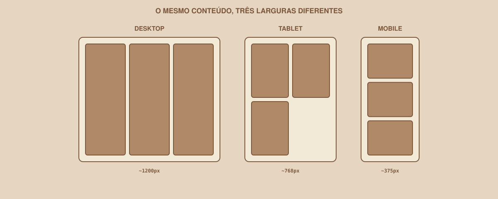
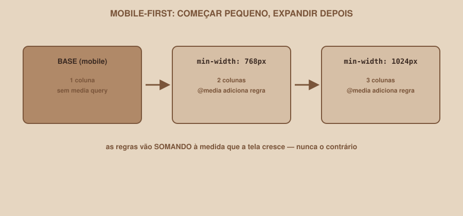

# Module 08 | Responsiveness

[Português](../docs/08-responsividade.md) · English

`WEEK 02 // Web Interface, Part 1: Layout`

---

## // The problem

Your Dashboard has three columns of cards, looking nice on your computer monitor. Now shrink the browser window to the width of a phone (~375px). What happens?

```
Desktop:  [ CARD ][ CARD ][ CARD ]
Phone:    [ CARD ][ CA][RD ][ CAR]
```

The cards get squeezed, the text wraps oddly, maybe a horizontal scrollbar shows up. The layout that worked perfectly at one width simply does not work at another.

## // What responsiveness means

> **RESPONSIVENESS: IN SIMPLE WORDS**
> It is a layout's ability to adapt to different screen sizes, keeping the interface usable on any of them, without having to create a separate version of the page for each device.

<div align="center">

</div>

## // Viewport

> **VIEWPORT: IN SIMPLE WORDS**
> It is the visible area of the screen where the page is displayed: the size of the browser window, or of the phone screen.

You already used this word in Module 02, in the `<meta name="viewport">` tag. It exists precisely to tell the phone's browser: "do not simulate a shrunken desktop screen, use the device's real width." Without this meta tag, the responsiveness this module teaches simply does not work on real phones.

## // Breakpoint

> **BREAKPOINT: IN SIMPLE WORDS**
> It is a specific screen width from which the layout changes its behavior, because the previous layout stopped working well.

A breakpoint is not a magic number you memorize from a list; it comes from a process:

1. Shrink the browser window width while watching your layout.
2. Notice at what point it starts to break (squeezed text, tiny cards, overlapping elements).
3. Decide right there, at that specific point, how the layout should adapt.
4. Create a CSS rule for that width.

## // Media query

```css
@media (max-width: 768px) {
    .dashboard-grid {
        grid-template-columns: repeat(2, 1fr);
    }
}
```

This rule says: "when the screen width is 768px or less, apply these rules on top of the normal rules." The CSS inside `@media` is only considered when the condition is true.

## // Mobile-first

<div align="center">

</div>

> **MOBILE-FIRST: IN SIMPLE WORDS**
> It means writing the base CSS thinking first about the small screen (without any media query), and then using `min-width` to *add* rules as the screen grows, instead of the other way around.

```css
/* Base: already designed for mobile, no media query at all */
.dashboard-grid {
    display: grid;
    grid-template-columns: 1fr;
    gap: 1rem;
}

/* From 768px up, add 2 columns */
@media (min-width: 768px) {
    .dashboard-grid {
        grid-template-columns: repeat(2, 1fr);
    }
}

/* From 1024px up, add 3 columns */
@media (min-width: 1024px) {
    .dashboard-grid {
        grid-template-columns: repeat(3, 1fr);
    }
}
```

Notice the logic: rules **add up** as the screen grows, never the other way around. This tends to produce CSS that is easier to follow than starting from desktop and "undoing" rules for smaller screens.

## // Responsiveness is not just "shrinking everything"

A common beginner mistake is thinking of responsiveness as "making everything smaller". In practice, it can mean:

- Changing the **number of columns** (3 cards → 2 → 1).
- **Rearranging** content (a sidebar that becomes a top menu, for example).
- **Hiding secondary elements**, when it makes sense (never hide essential content).
- Changing the **navigation** (a horizontal menu that becomes a menu icon on phones).
- Adjusting **spacing**, not just font size.
- **Enlarging the touch area** of buttons: on touch screens, elements that are too small are hard to hit with a finger.

## // Really testing responsiveness

You do not need a physical phone to test. Most browsers have a built-in tool to simulate screen sizes (part of DevTools, which Module 12 explores further). For now, manually resizing the browser window already reveals most problems.

> **QUICK TEST**
> Shrink the window width little by little and watch: does horizontal scrolling appear (a sign something is "leaking" off the screen)? Is the text still readable? Are the buttons still easy to click/tap? Do the cards wrap in a way that still makes sense, or do they get messy?

## // Common mistakes

| Mistake | Why it happens | How to fix it |
|---|---|---|
| Forgetting `<meta name="viewport">` | It looks like a Module 02 detail, easy to skip | Without it, real phones ignore all your responsiveness |
| Picking breakpoints "from a table" without testing | Copying numbers from another project without looking at your own layout | Actually resize your layout and find where it breaks |
| Mixing mobile-first and desktop-first in the same file | Starting one way, changing your mind halfway | Pick one approach (we recommend mobile-first) and stay consistent |
| Elements too small to tap on a phone | Thinking only about the mouse, which is more precise than a finger | Ensure a minimum touch area (about 44px) on important buttons and links |

## // Guided practice

1. Open the Dashboard in the browser and shrink the window width to about 768px. Notice where the 3-column layout starts to get tight.
2. Add the `min-width: 768px` media query, going down to 2 columns below that (following the mobile-first logic: the base is already 1 column).
3. Keep shrinking to ~375px and confirm the 1-column version (the base, with no media query) is readable and has no horizontal scrolling.
4. Repeat the process for the navbar: should it behave differently on small screens?

## // Practice on your own

> **CHALLENGE**
> Open the Profile screen at ~375px wide. If the avatar and the information are side by side (Flexbox, from Module 06), add a media query that rearranges them into a column at that width, using `flex-direction: column` inside the `@media`.

## // Applying it to the week's project

1. Confirm `<meta name="viewport">` is present on all three pages.
2. Add mobile-first media queries to the Dashboard, adapting the card grid.
3. Review Login and Profile at the three reference widths (~375px, ~768px, ~1200px), adjusting whatever breaks.
4. Commit: `git commit -m "Add mobile-first responsiveness to the three screens"`.

## // Checkpoint

> **BEFORE MOVING ON, THINK ABOUT THIS**
> A card looks right on desktop, but goes beyond the screen width on a phone, causing horizontal scrolling. What would you investigate first?

Answer: first, whether there is a fixed pixel `width` on the card or on some element inside it that does not adapt to narrow screens; a common suspect is an image without `max-width: 100%`, or a fixed `width` larger than the available screen. It is also worth checking whether `box-sizing: border-box` is applied, since padding/border without it can push the element out of the available space.

## // Module summary

- [ ] I can explain what the viewport is and why the meta tag matters.
- [ ] I know what a breakpoint is and how to decide where to place one, based on my own layout.
- [ ] I can write a media query, including the mobile-first logic.
- [ ] I know responsiveness involves more than just "shrinking everything".
- [ ] I tested my project's three screens at at least three different widths.

---

**Next module:** `09-figma-to-code.md`: putting it all together: how to break down a Figma screen before writing the first line of code.

`Study Material // Coffee & Code`
