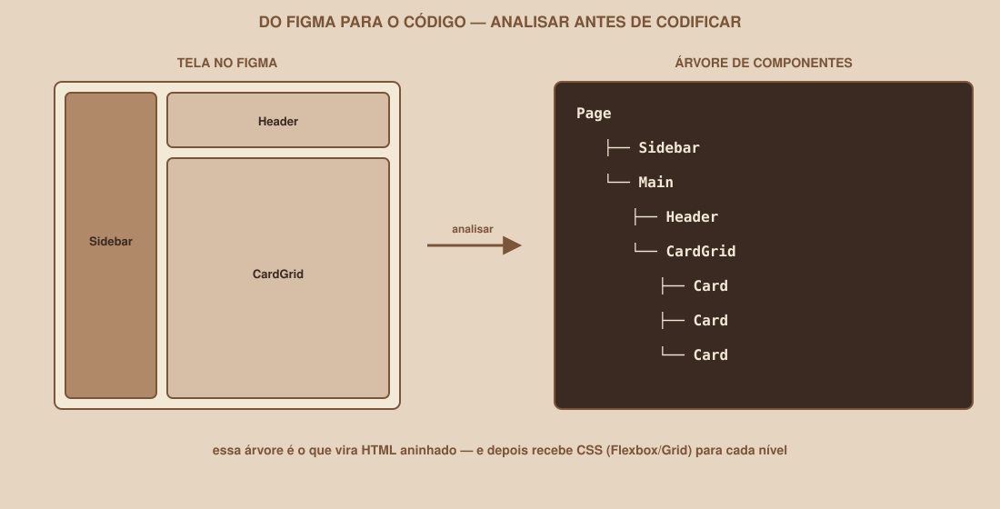

# Module 09 | From Figma to Code

[Português](../docs/09-figma-para-codigo.md) · English

`WEEK 02 // Web Interface, Part 1: Layout`

---

## // Why this module exists

You already know HTML, CSS, Flexbox, Grid and responsiveness: the tools. What is still missing is the reasoning that connects a Figma screen to code: how to look at a design and decide, before writing any tag, which elements exist and how they are organized.

Skipping this analysis is the most common cause of messy HTML: people who start straight with code tend to create ad-hoc structure, without a clear hierarchy, and only find the problems later, when they are more expensive to fix.

## // Analyzing before coding

Take the Dashboard screen from your Figma prototype (or this guide's visual reference, if you do not have yours yet). Before opening the code editor, ask: **which big regions exist here?**

```text
┌──────── Sidebar ────────┐
│                         │
│                         │
└─────────────────────────┘

┌──────────── Main ──────────────┐
│ Header                         │
│                                │
│ Cards                          │
│                                │
└────────────────────────────────┘
```

At this point, you are not thinking in HTML yet, only in regions. Two big areas: a sidebar and a main area, which in turn has a header and a grid of cards inside it.

## // Breaking it down into a tree

The next step is to turn these regions into a hierarchy, exactly the parent/child relationship you learned in Module 02:

<div align="center">

</div>

```text
Page
├── Sidebar
└── Main
    ├── Header
    └── CardGrid
        ├── Card
        ├── Card
        └── Card
```

This tree **is** the HTML, just not written with tags yet:

```html
<div class="page">
  <aside class="sidebar">...</aside>
  <main>
    <header>...</header>
    <div class="card-grid">
      <div class="card">...</div>
      <div class="card">...</div>
      <div class="card">...</div>
    </div>
  </main>
</div>
```

Notice that the HTML structure follows exactly the tree you drew; each nesting level matches a level of the tree. Once you have this structure, CSS comes in: Flexbox or Grid for `.page` (arranging sidebar and main), Grid for `.card-grid`, Flexbox for the content inside each `.card`.

## // What NOT to do: copy coordinates

Figma shows the exact position of every element in pixels (X, Y). It is tempting to try to replicate that exact position in CSS:

```css
/* DON'T DO THIS */
.card {
    position: absolute;
    top: 120px;
    left: 340px;
}
```

> **WHY TO AVOID `POSITION: ABSOLUTE` TO BUILD THE WHOLE PAGE**
> Absolute positioning takes the element out of the page's normal flow; it stops reacting to the content around it, to the screen size, to anything. A layout built entirely with fixed coordinates breaks at the first screen size different from the one it was measured on. It is the opposite of what Flexbox and Grid were designed to solve: a layout that adapts, not one that is fixed.

That does not mean `position: absolute` is never useful; it has legitimate, occasional uses (a badge in the corner of an avatar, for example). The problem is using it as the *main* strategy to build the whole page, trying to replicate Figma coordinates one by one.

## // The process, summarized

1. **Look at the whole screen** and identify the big regions (usually 2 to 4 main blocks).
2. **Draw the tree**: who is a child of whom.
3. **Write the HTML** following exactly that tree, using semantic tags where it makes sense.
4. **Choose the layout tool** for each level: Flexbox for sequences in one direction, Grid for two-dimensional structures.
5. **Only then** adjust spacing, colors and fine details.

## // Guided example: analyzing the Profile

Apply the same process to the Profile screen:

```text
Profile
├── Header (with navigation, same as the other screens)
└── Main
    ├── Avatar
    ├── UserInfo (name, e-mail)
    └── Actions (buttons)
```

Question before coding: should `Avatar`, `UserInfo` and `Actions` be in a column, or side by side? That decision comes from the screen's design, and determines whether `Main` uses `flex-direction: column` or `row`.

## // Common mistakes

| Mistake | Why it happens | How to fix it |
|---|---|---|
| Skipping the analysis and opening the editor right away | It seems faster | Without the tree, it is common to rewrite the structure several times along the way |
| Trying to replicate Figma's pixel positions | Figma shows exact numbers, it seems "more precise" | Think in regions and relationships, not coordinates |
| A tree with many unnecessary levels | "Wrapping" everything in extra divs just in case | Each level of the tree should represent a real region of the screen, not an empty div |

## // Guided practice

1. Open the Dashboard prototype in Figma (or this guide's reference).
2. On paper or in a simple text editor, draw the component tree, as in the example in this section.
3. Compare your tree with the HTML you already wrote in the previous modules; do they match? If not, adjust the structure before moving on.

## // Practice on your own

> **CHALLENGE**
> Draw the component tree of the Login screen, including the form. Then compare it with the `login.html` you already have: is there any region left without a clear tag representing it (for example, the whole form without a container around it)?

## // Applying it to the week's project

1. Draw the component tree of your project's three screens, based on the Week 01 Figma.
2. Review the HTML of each screen, confirming that the tag structure matches the tree you drew.
3. Fix any part where `position: absolute` is being used to build the main layout: replace it with Flexbox or Grid.
4. Commit: `git commit -m "Review the HTML structure of the three screens based on the Figma analysis"`.

## // Checkpoint

> **BEFORE MOVING ON, THINK ABOUT THIS**
> Why does drawing the component tree *before* writing HTML save time, instead of being an extra step?

Answer: because structural decisions (what is a child of what, which regions exist) are cheaper to change on paper than after many lines of HTML and CSS have already been written on top of a wrong structure. The tree works as a quick draft that prevents rework.

## // Module summary

- [ ] I can break a screen down into regions before writing any tag.
- [ ] I can turn those regions into a parent/child tree.
- [ ] I know why `position: absolute` should not build the whole page.
- [ ] I have already drawn the component tree of my project's three screens.

---

**Next module:** `10-tailwind.md`: now that CSS is solid, a faster way to write the same rules.

`Study Material // Coffee & Code`
