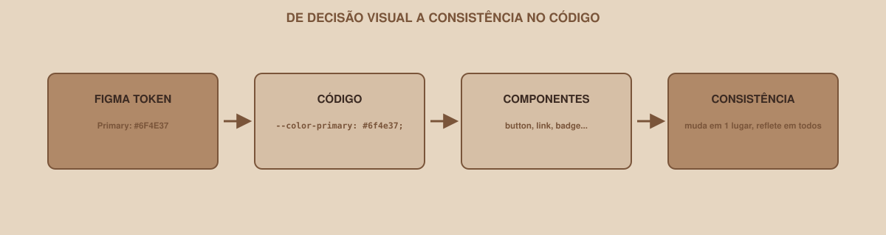

# Module 11 | Design System in Code

[Português](../docs/11-design-system-no-codigo.md) · English

`WEEK 02 // Web Interface, Part 1: Layout`

---

## // Before you start

Go back to the `/docs/design-system.md` file you created in Week 01. It has colors, typography and spacing documented, but, until this module, none of it really exists in your CSS. Every color you applied in the previous modules was typed by hand, at the risk of coming out slightly different in each place. This module closes that gap.

## // The problem, again

You already saw this idea in Week 01: five screens, five slightly different variations of the "same" primary color, because the hex was typed from memory on each one. The same risk exists in code:

```css
.botao-primario { background-color: #6f4e37; }
.link { color: #6f4e37; }
.card-destaque { border-color: #6f4e38; } /* did you spot the typo? */
```

One wrong digit, and the "same" color is no longer the same.

## // CSS Custom Properties (CSS variables)

> **CSS CUSTOM PROPERTIES: IN SIMPLE WORDS**
> They are real variables inside CSS: you define a value once, give it a name, and reuse that name anywhere in the file. Changing the value in the definition automatically changes it everywhere that name is used.

```css
:root {
    --color-primary: #6f4e37;
    --color-background: #f7f2ed;
    --color-text: #241c18;
}
```

`:root` is the highest element on the page; declaring variables there makes them available in any selector across the whole file. The `--` prefix marks it as a custom property, not a native CSS property.

### > Using the variable

```css
.botao-primario {
    background-color: var(--color-primary);
}

.link {
    color: var(--color-primary);
}
```

`var(--color-primary)` fetches the value defined in `:root`. Now there is **a single place** to change the primary color of the whole project.

## // From Figma to code, the full path

<div align="center">

</div>

```text
FIGMA TOKEN          Primary: #6F4E37
      ↓
CODE                 --color-primary: #6f4e37;
      ↓
COMPONENTS           button, link, badge... use var(--color-primary)
      ↓
CONSISTENCY          change in 1 place, reflected everywhere
```

## // Carrying over the whole design system

Revisit `/docs/design-system.md` from Week 01 and turn each decision into a variable:

```css
:root {
    /* Colors */
    --color-primary: #6f4e37;
    --color-background: #f7f2ed;
    --color-text: #241c18;
    --color-error: #b3261e;

    /* Typography */
    --font-family-base: 'Inter', sans-serif;
    --font-size-base: 1rem;
    --font-size-heading: 1.75rem;
    --line-height-base: 1.5;

    /* Spacing */
    --spacing-xs: 4px;
    --spacing-sm: 8px;
    --spacing-md: 16px;
    --spacing-lg: 24px;

    /* Radius */
    --radius-md: 8px;
}
```

## // Applying it to reusable components

### > Button

```css
.botao-primario {
    background-color: var(--color-primary);
    color: white;
    padding: var(--spacing-sm) var(--spacing-md);
    border-radius: var(--radius-md);
    border: none;
}
```

### > Input

```css
input {
    padding: var(--spacing-sm);
    border-radius: var(--radius-md);
    font-family: var(--font-family-base);
}
```

### > Card

```css
.card {
    padding: var(--spacing-md);
    border-radius: var(--radius-md);
    background-color: white;
}
```

Notice: no loose value (`#6f4e37`, `16px`) appears directly in these components; everything references a central variable.

## // States: beyond the default

A mature design system does not only define the "normal" look of a component; it also defines how it behaves in different states:

| State | When it happens | Example rule |
|---|---|---|
| `default` | Normal state, no interaction | `.botao-primario { ... }` |
| `:hover` | Mouse over the element | `.botao-primario:hover { background-color: ...; }` |
| `:focus` | Element focused via keyboard | `.botao-primario:focus { outline: ...; }`: we explore this in Module 12 |
| `:disabled` | Disabled element | `.botao-primario:disabled { opacity: 0.5; }` |
| error | Form field with an invalid value | Usually an extra class, such as `.input-erro` |
| success, when relevant | Confirmation of an action | Usually an extra class, such as `.mensagem-sucesso` |

You do not need to implement all these states this week, but it is worth documenting them, even as a to-do, so you do not forget they exist.

## // Common mistakes

| Mistake | Why it happens | How to fix it |
|---|---|---|
| Mixing variables with loose values | Forgetting to use `var()` somewhere | Review: no design system color or spacing should appear as a literal value outside `:root` |
| Unclear variable names (`--cor1`, `--tam2`) | Rushing when creating them | Name by function (`--color-primary`), not by appearance (`--cor-marrom`): the function stays the same even if the color changes |
| Forgetting to update `/docs/design-system.md` after creating the variables | The document and the code get out of sync | Treat the documentation file as part of the work, not an optional extra |

## // Guided practice

1. Create the `:root` block at the top of your `styles.css`, with the color, typography and spacing variables from your Week 01 design system.
2. Replace the loose values you used in the previous modules (on buttons, cards, the form) with `var(--variable-name)`.
3. Test it: change the value of `--color-primary` in `:root` and visually confirm that every component using that color changes together.

## // Practice on your own

> **CHALLENGE**
> Add a `--spacing-xl` variable that does not exist yet in your design system, pick a value consistent with the existing scale (for example, if your scale is 4/8/16/24, the next logical step would be 32 or 40), and use it on some larger spacing in your project, such as the distance between Dashboard sections.

## // Applying it to the week's project

1. All the project's colors, typography and spacing should come from variables in `:root`.
2. Update `/docs/design-system.md`, adding the implementation section (see the template below).
3. Commit: `git commit -m "Move the design system to CSS Custom Properties"`.

Suggested template to add to `/docs/design-system.md`:

```markdown
## Web Implementation

### Colors

| Token | Value | Use |
|---|---|---|
| --color-primary | #6f4e37 | main actions |
| --color-background | #f7f2ed | background |
| --color-text | #241c18 | text |

### Spacing

- xs: 4px
- sm: 8px
- md: 16px
- lg: 24px

### Implemented components

- Button
- Input
- Card
- Navbar
```

## // Checkpoint

> **BEFORE MOVING ON, THINK ABOUT THIS**
> You decide to change the primary color of the whole project. With well-applied CSS Custom Properties, how many places in the code need to be edited?

Answer: just one, the variable's definition inside `:root`. Every component that uses `var(--color-primary)` reflects the change automatically, without editing each rule individually.

## // Module summary

- [ ] I know what CSS Custom Properties are and how to declare them in `:root`.
- [ ] I can use `var()` to apply a variable in any rule.
- [ ] I carried my Week 01 design system's colors, typography and spacing over to real variables.
- [ ] I can list the states a component can have, beyond the default.
- [ ] I updated `/docs/design-system.md` with the implementation section.

---

**Next module:** `12-accessibility.md`: your project works for you. Let's make sure it works for more people.

`Study Material // Coffee & Code`
