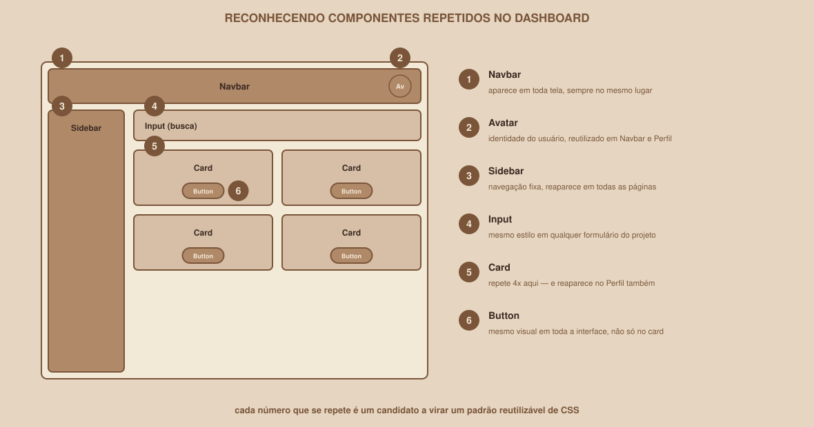

# Module 13 | Componentization and Themes

[Português](../docs/13-componentizacao-e-temas.md) · English

`WEEK 02 // Web Interface, Part 1: Layout`

---

## // The problem

Look at your own CSS at this point in the week. You have probably written the same button rule more than once:

```html
<button class="...">Save</button>
<button class="...">Sign in</button>
<button class="...">Edit</button>
```

Each button, rewritten from scratch, risks coming out slightly different: one with `padding: 12px`, another with `padding: 10px 14px`, without anyone deciding that deliberately.

## // Thinking in components

> **COMPONENTIZATION: IN SIMPLE WORDS**
> It means recognizing that a piece of interface repeats, and treating it as a reusable unit (a class, a pattern) instead of recreating it from scratch every time it shows up.

This week, without using any component framework (React comes in future weeks of the club), "componentizing" means: identifying repeated patterns and reusing consistent CSS classes for them.

<div align="center">

</div>

In your own Dashboard, there are very likely at least these repeated patterns:

- **Navbar**: shows up on every screen.
- **Card**: repeats several times in the grid, and may show up again on the Profile.
- **Button**: used on Login, Dashboard and Profile.
- **Input**: used in the Login form, and maybe in a Dashboard search.
- **Avatar**: reused in the Navbar and the Profile.

## // If you are just starting

The goal, at this level, is simple: identify the repeated components in your project, and make sure each one uses the **same CSS class** everywhere it appears.

```css
.botao-primario {
    background-color: var(--color-primary);
    color: white;
    padding: var(--spacing-sm) var(--spacing-md);
    border-radius: var(--radius-md);
}
```

```html
<button class="botao-primario">Save</button>
<button class="botao-primario">Sign in</button>
<button class="botao-primario">Edit</button>
```

Three buttons, a single definition. If you need to change the look of the primary button, you change it in one place and it is reflected in all three.

## // If you already have experience

### > Organizing styles

A single `styles.css` grows fast and becomes hard to navigate. A common organization, without any build tool:

```text
css/
├── base.css          /* reset, base typography, :root with the variables */
├── components.css    /* .botao-primario, .card, .input, .navbar */
├── layout.css        /* .dashboard-grid, overall page structure */
└── utilities.css      /* small, reusable classes, if needed */
```

Each file is connected with its own `<link>`, or combined via `@import` at the top of a main file.

### > Composition instead of duplication

```css
.botao-base {
    padding: var(--spacing-sm) var(--spacing-md);
    border-radius: var(--radius-md);
    border: none;
    font-family: var(--font-family-base);
}

.botao-primario {
    background-color: var(--color-primary);
    color: white;
}

.botao-secundario {
    background-color: transparent;
    color: var(--color-primary);
    border: 1px solid var(--color-primary);
}
```

```html
<button class="botao-base botao-primario">Sign in</button>
<button class="botao-base botao-secundario">Cancel</button>
```

`botao-base` carries what is common to any button; `botao-primario`/`botao-secundario` carry only the difference. This avoids repeating `padding` and `border-radius` in each variation.

### > Separating structure and presentation

Avoid naming classes by appearance (`.texto-azul`, `.caixa-grande`); prefer naming them by function (`.titulo-secao`, `.card-destaque`). If the color "blue" changes to something else in the future, a class called `.texto-azul` ("blue text") ends up with a name that no longer matches reality.

## // Light/dark theme

> **DON'T START WITH THE CODE**
> Before any CSS, ask: what changes between the light and dark theme in your project? Usually, the answer is: colors and tokens, not the structure, not the layout, not the components themselves.

Using the CSS Custom Properties you already created in Module 11:

```css
:root {
    --bg: #ffffff;
    --text: #181818;
}

[data-theme="dark"] {
    --bg: #181818;
    --text: #ffffff;
}
```

```css
body {
    background-color: var(--bg);
    color: var(--text);
}
```

The trick is in `[data-theme="dark"]`: an attribute selector that overrides the `:root` variables when the element (usually `<html>` or `<body>`) has the attribute `data-theme="dark"`:

```html
<html data-theme="dark">
```

Every component that already uses `var(--bg)` or `var(--text)` switches theme automatically, without needing a second version of each rule.

### > `prefers-color-scheme`

```css
@media (prefers-color-scheme: dark) {
    :root {
        --bg: #181818;
        --text: #ffffff;
    }
}
```

This media query detects the theme preference already set in the person's operating system (many phones and computers have this option). You can use it as an automatic default, and still combine it with `data-theme` to let the person switch manually within your site.

> **IMPORTANT: WITHOUT TURNING INTO A JAVASCRIPT CLASS**
> A button that switches the theme when clicked requires JavaScript to toggle the `data-theme` attribute dynamically. That is not the focus this week. The CSS above is already enough for the basic deliverable (with `prefers-color-scheme`, the theme changes automatically with the system setting). A manual theme toggle button is an extra challenge, specifically marked for experienced members.

## // Common mistakes

| Mistake | Why it happens | How to fix it |
|---|---|---|
| Rewriting the same component several times | Not stopping to notice the repeated pattern | Ask, with each new element: "am I recreating something that already exists?" |
| Naming a class by appearance, not function | It feels more direct at the moment | Name it by role (`.card-destaque`), not by its current color/size |
| Trying to implement theme switching with JavaScript before the CSS is ready | Excitement to go further | First make sure the theme variables cover everything; JavaScript is just the trigger afterward |

## // Guided practice

1. List, in plain text, all the components that repeat in your project (Navbar, Card, Button, Input, Avatar; adjust to what exists in your case).
2. For each one, confirm: is there a single CSS class reused everywhere it appears? If not, unify it.
3. Add the `[data-theme="dark"]` block to your `styles.css`, with at least `--bg` and `--text` redefined.
4. Temporarily add `<html data-theme="dark">` just to visually test the switch; then go back to `data-theme="light"` or remove the attribute.

## // Practice on your own

> **CHALLENGE**
> Add the `prefers-color-scheme: dark` media query, making the dark theme turn on automatically when the person's system is set to it. Test it by changing the theme setting of your own operating system (most have this option under Settings) and reloading the page.

## // Applying it to the week's project

1. Confirm that Button, Card, Input and Navbar each use a single reused CSS class, consistent across the three screens.
2. Add light/dark theme support via `data-theme` and/or `prefers-color-scheme`, covering at least background color and text color.
3. Commit: `git commit -m "Consolidate reusable components and add dark theme support"`.

## // Checkpoint

> **BEFORE MOVING ON, THINK ABOUT THIS**
> You want to add a button that toggles between light and dark theme when clicked. Is the CSS you already wrote in this module enough for that to work, or is something missing?

Answer: JavaScript is missing. The CSS already prepares the whole base (the variables changing according to `data-theme`), but toggling that attribute in response to a click is a dynamic action (behavior, not structure or presentation) that only JavaScript handles. That is exactly why this button is marked as a deeper challenge, not as part of the basic deliverable.

## // Module summary

- [ ] I can identify repeated components in my own project.
- [ ] I can reuse a single CSS class for each component, instead of recreating each instance.
- [ ] I can split styles into organized files, and compose base classes + variations.
- [ ] I can implement a light/dark theme via CSS Custom Properties and `data-theme` or `prefers-color-scheme`.
- [ ] I know why a manual theme toggle button needs JavaScript, and why it stays as an extra challenge.

---

**Next module:** `14-guided-project.md`: putting it all together, from start to finish, on the three complete screens.

`Study Material // Coffee & Code`
